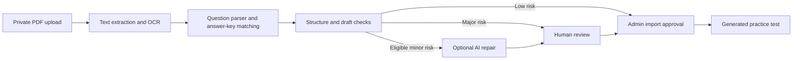

# Grit

**Digital SAT practice and a content production workspace for educators.**

Students take timed tests, review their answers, and study vocabulary. Educators organize classes, build and assign practice, and turn source PDFs into editable questions with page-level evidence.

## Outcomes

- **Learning platform.** Grit served **40 students monthly**, with timed assessments, automated scoring, performance analytics, and FSRS vocabulary review.
- **Document intelligence.** The ingestion pipeline combines Cohere OCR, deterministic validation, and source-grounded LLM repair. Confidence and evidence checks route drafts to human review. The project tracks ingestion cost and latency.
- **Question classification.** The project benchmarked **six classifiers** using TF-IDF and ModernBERT on **1,710 SAT questions** for skill and difficulty prediction. The selected **TF-IDF + Linear SVM** reached **0.936 validation macro-F1** and **31 ms p95 API latency**.
- **Personalized learning.** The project scope includes Bayesian IRT mastery tracking, adaptive testing, and an offline-tested RAG tutor designed to cite its sources and prevent answer leakage during active practice.

[Architecture](docs/architecture.md)

## Measured ingestion and application performance

| What changed | Before | After |
| --- | ---: | ---: |
| Questions recovered across 36 PDF imports | 2,917 | **3,140** |
| Matched source answer-key entries | 1,654 | **2,415** |
| Imports with exactly 98 questions and 98 matched keys | 3 of 36 | **18 of 36** |
| Full-test submission latency at p95 | 28.66 s | **2.27 s** |
| Vocabulary review latency at p95 | 2.77 s | **0.98 s** |

The ingestion evaluation separates gains from parser changes on identical saved OCR from gains that required fresh OCR. The counts measure extraction and structural completeness. The latency figures come from a staging run with seven concurrent synthetic students. That run recorded zero request errors across 840 calls, while full-test start and resume still exceeded the two-second p95 target. [Ingestion evaluation](docs/evals/ingestion-refinement.md) · [Latency report](docs/evals/student-api-latency.md)

## What you can do

| Workspace | Workflow |
| --- | --- |
| **Student** | Take timed Reading and Writing or Math modules, save responses, mark questions for review, and inspect scores by section and domain. Study assigned or personal vocabulary decks with FSRS scheduling. |
| **Educator** | Manage classes and student access, curate a question bank, assemble full-length tests and practice sets, assign work, and track student progress. |
| **Content review** | Upload a PDF, inspect extracted questions against page images and answer keys, resolve flagged drafts, and generate a test from approved content. |

## How PDF ingestion works



The worker uses PDF text extraction and Cohere Parse OCR to recover questions, answer keys, and visual evidence. Full-length imports are checked against the expected **27 / 27 / 22 / 22** module counts and distinct question identities. A structural failure stops automated review and routes the import to reprocessing.

With a review API key configured, eligible drafts can receive source-grounded repairs. The worker validates proposed changes and retains the parser original for comparison. Every AI-reviewed draft goes to a human reviewer, and test generation requires an admin approval action. [Worker and review details](backend/README.md#pdf-ingestion-pipeline)

## Architecture

**React · TypeScript · Node.js · Supabase · Python/FastAPI · scikit-learn · Hugging Face Transformers · MLflow**

The web stack handles accounts, assessment delivery, scoring, and content review. The ML architecture adds a FastAPI inference boundary, scikit-learn and Transformers model experiments, and MLflow experiment tracking. [Service boundaries and data flows](docs/architecture.md)

| Path | Responsibility |
| --- | --- |
| [`frontend/`](frontend/) | React, TypeScript, and Vite student and admin workspaces |
| [`backend/supabase/`](backend/supabase/) | Postgres schema, Auth, Storage, row-level security, and Deno Edge Functions |
| [`backend/worker/`](backend/worker/) | Node and TypeScript worker for extraction, OCR, parsing, and draft review |
| [`backend/scripts/`](backend/scripts/) | Local account provisioning and integration checks |
| [`docs/`](docs/) | Feature notes, engineering evaluations, and design plans |

The browser uses Supabase Auth and role-scoped Edge Functions. Postgres row-level security protects application data. The ingestion worker accesses private storage and writes drafts through the backend. [Backend architecture](backend/README.md#architecture)

## Run locally

Start Supabase with Docker and the repository's pinned CLI. Run these commands from the repository root in PowerShell.

```powershell
cd backend
npx --yes supabase@2.115.0 start
npx --yes supabase@2.115.0 functions serve
```

In a second terminal, copy `frontend/.env.example` to `frontend/.env` and set the local Supabase URL and anon key. From `backend/`, use `npx --yes supabase@2.115.0 status -o env` to find the local values.

```powershell
cd frontend
npm ci
npm run dev
```

Open [localhost:5173](http://localhost:5173). See the backend guide for local account provisioning and the optional OCR worker. The PDF replay corpus lives in the Git-ignored `Tests Unparsed/` directory. [Local backend setup](backend/README.md#local-development) · [Worker setup](backend/README.md#worker-setup) · [Verification commands](backend/README.md#verification)

## Engineering references

- [AI feature designs](docs/plans/ai-integration.md) and [content intelligence plan](docs/plans/content-intelligence-copilot.md)
- [Frontend guide](frontend/README.md), [product notes](docs/product.md), and [design system](docs/design/design-system.md)
