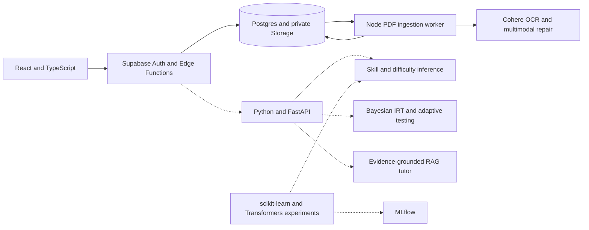

# Grit architecture

Grit combines a student assessment application, an educator content workspace, and a machine learning layer for question classification, mastery estimation, adaptive testing, and tutoring. The first two run through the React application, Supabase backend, and Node ingestion worker in this checkout. The Python service and personalization flows below describe the broader project architecture.

## System map

Solid lines represent paths in the checkout. Dotted lines show the ML and personalization design.

## Assessment and vocabulary

The browser authenticates through Supabase and calls role-scoped Edge Functions. Postgres stores class assignments, test definitions, attempts, responses, and scores. Students move through timed modules, submit for automated scoring, and review section and domain performance. The vocabulary workflow schedules reviews using FSRS. Educators use the same content and assignment model to assemble practice and inspect progress. [Backend guide](../backend/README.md)

## Multimodal content ingestion

The Node worker extracts available PDF text and uses Cohere OCR when pages need it. It links questions and proposed answers to source pages, checks module structure and draft quality, and routes eligible drafts through source-grounded LLM repair. Confidence thresholds and field validation govern whether a proposed edit can be applied to a draft. Human review follows AI repair, and an educator controls publication. The evaluation design tracks OCR and repair cost, processing latency, and review outcomes. [Ingestion evaluation](evals/ingestion-refinement.md) · [Evaluation criteria](evals/ai-content-ingestion-evaluation.md)

## Question classification

The classifier benchmark compared six TF-IDF and ModernBERT candidates on 1,710 SAT questions for skill and difficulty prediction. The selected TF-IDF + Linear SVM recorded 0.936 validation macro-F1 and 31 ms p95 API latency in the project summary. scikit-learn supports the sparse baseline and Hugging Face Transformers supports ModernBERT experiments. The architecture uses MLflow to track runs and model selection, and FastAPI as the inference boundary. Skill and difficulty predictions are reviewed metadata attached to a question, with source labels retaining priority.

## Mastery and adaptive testing

Bayesian item response theory estimates mastery from graded responses and item difficulty. The learner model tracks skill-level ability and uncertainty so adaptive selection can weigh difficulty fit, coverage, prior exposure, and where more evidence would help. The design routes selected items through the existing assignment and attempt workflow. [Mastery and assignment design](plans/ai-integration.md#2-interpretable-mastery-and-adaptive-assignment-engine)

## Tutor grounding and answer controls

The tutor architecture retrieves approved question and concept evidence, cites supporting material, and checks attempt state before choosing what context can enter the prompt. During active practice, the tutor can offer progressive hints while answers and explanations stay outside its context. Full-length attempts disable tutor access. After grading and explanation release, the tutor can cite evidence in worked explanations. Offline evaluation covers retrieval, citation quality, and adversarial attempts to elicit answers. [Tutor design and evaluation criteria](plans/ai-integration.md#3-evidence-grounded-sat-tutor)
